20-11-2026
Feedback en Grid
--
Wat heb ik gedaan?
We begonnen met het vergelijken van onze schetsen. Ik en Mattijs hebben dit bij elkaar gechekt. Ik ben alleen helaas mijn invulveld kwijt... Ik weet gelukkig wel nog wat er ongeveer uit kwam. Mijn la idee was het beste bij veel van de categorieën. Ik moet wel nog even kijken wat ik met light en dark mode ga doen en hoe de la gaat schalen.

Het concert idee deed het ook niet slecht op de test en was wel makkelijker te schalen. Ik twijfelde alleen nogal naar de mogelijkheid ervan. Knoppen op een draaiende wereldbol die meedraaien en dus ook verdwijnen naar de andere kant + bestuurbaar met de slider. Het klonk nogal onrealistisch vonden we.

Het krant idee vonden we zelf een beetje saai en niet heel uitdagend. Deze viel dus al snel af.

Bij het gesprek heb ik de schetsen van de la en de doorklikpagina gepresenteerd. Ze waren hier erg enthousiast over! Vooral het overbrengen van het gevoel van verschillende albums doormiddel van verschil in opmaak vonden ze heel cool. De la zelf was ook erg goed maar ik moet de point of view van de la nog even goed uitdenken (vanaf boven werkt niet en vanaf voor ook niet). De feedback die ik kreeg was dat ik het wel mogelijk voor mezelf moest houden. Ik had veel animaties in mijn hoofd zitten wat wel lastig kan worden. Ik ben wel blij dat dat mijn feedback is, want het laat weten dat ik ambitieus bezig ben en er verder weining op aan te merken is. We hebben als laatst besproken dat ik echt lang niet elk album hoef uit te werken, want dat is veel teveel werk. 1-3 albums is genoeg.

Bij de extra les hebben we grids besproken. Dit was wel een taai onderwerp maar heel erg nuttig. Bij het plaatsen van meerdere elementen op de horizontale as gaat dit me echt heel erg helpen denk ik. We zijn ook bezig geweest met het media element. Voor nu was het om grids aan te passen op basis van schermbreedte. Ook heb ik gevraagd aan Sanne hoe ik tekst kan schalen op basis van de schermgrootte. Dit kon via het Clamp element. Hieronder staan wat screenshots van de oefeningen.

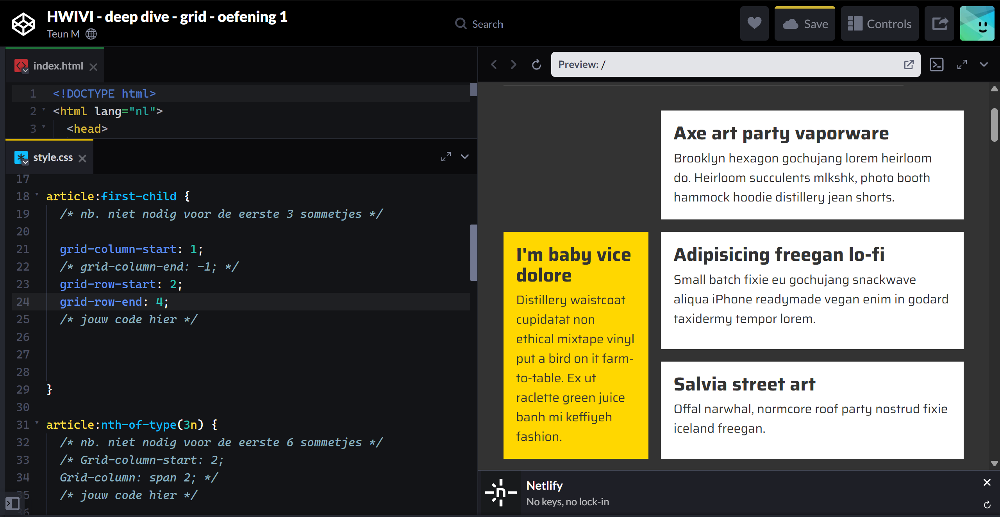
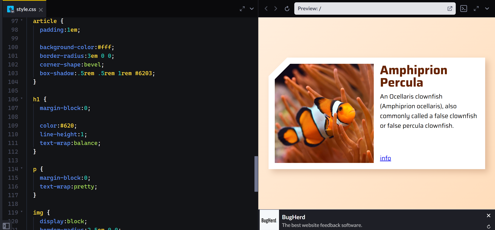
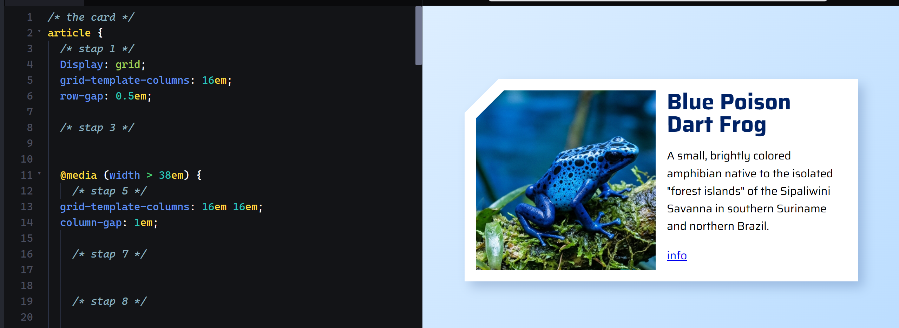
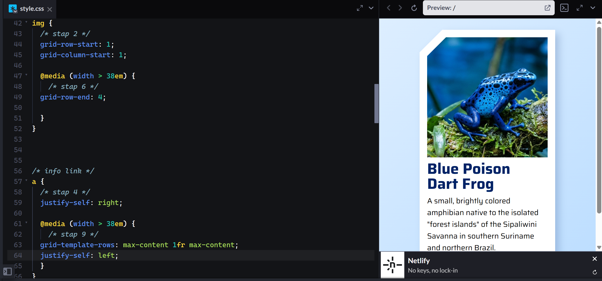

19-11-2026
Schetsen en Styleguide
--
Wat heb ik gedaan?
Ik heb 4 schetsen gemaakt aan de hand van 3 ideeën. Mijn ideeën zijn:

- Een la met alle albums. Je kan er dan een album uit halen en dat kom je op een pagina die het gevoel van dat album weergeeft doormiddel van opmaak. Elke doorklikpagina voelt dus helemaal anders.
- De concert scene waar ik bij geweest ben. De wereldbol draait langzaam en op de wereldbol staan de albums. Onderaan de bol staan de oude albums en het spiraalt omhoog naar de nieuwe met Bully bovenaan omdat het de Bully tour is. Je kan zelf de bol ook draaien met een slider.
- Een krant aangezien Ye veel in het nieuws geweest is. Elk element van de krant gaat ergens anders over en leid je naar een pagina over dat onderwerp. Deze vind ik zelf wel het mist sterk.

Bij het maken van de schetsen heb ik voor de la ook een doorklikpagina geschetst, omdat ik de la het leukste idee vind.

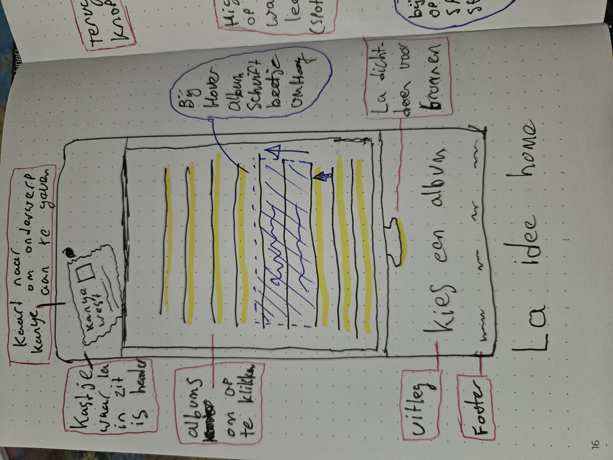
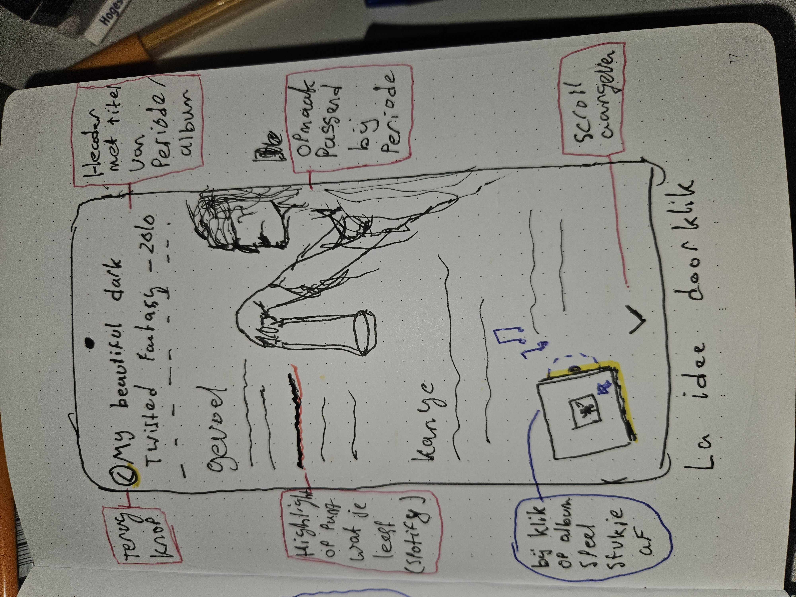
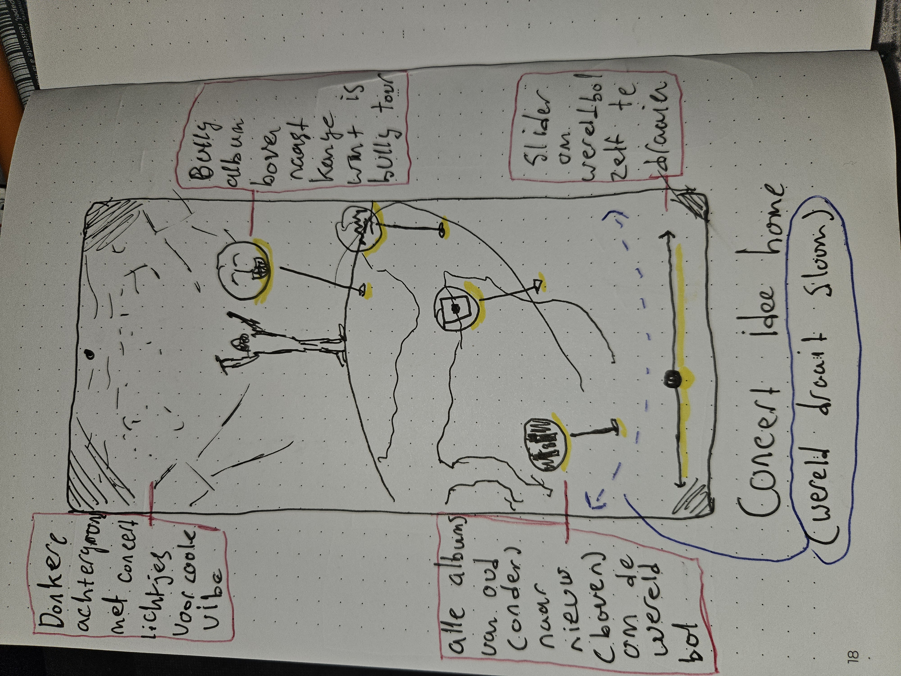
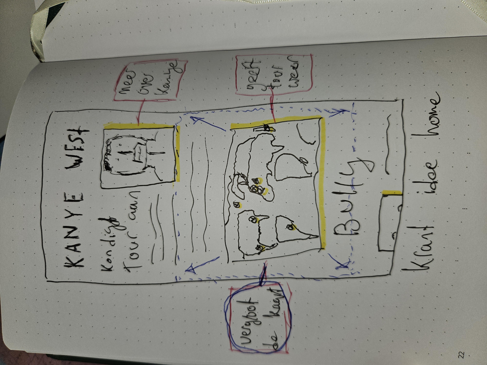

Ik heb ook een soort mini styleguide gemaakt. Ik heb vooral gekeken naar typografie en kleurgebruik voor verschillende albums om dat verschil in gevoel te visualiseren. Hier zijn enkele voorbeelden:

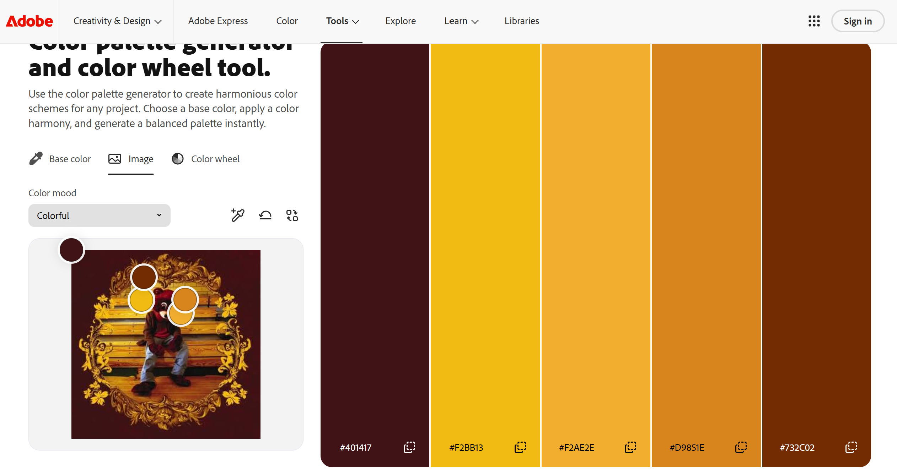
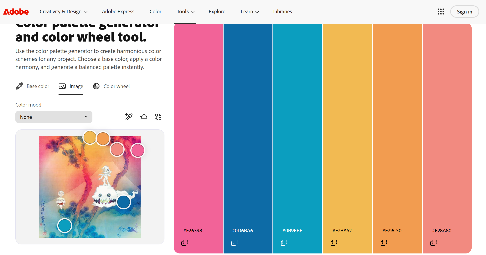
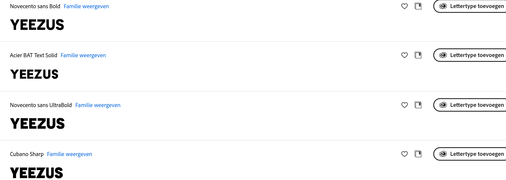
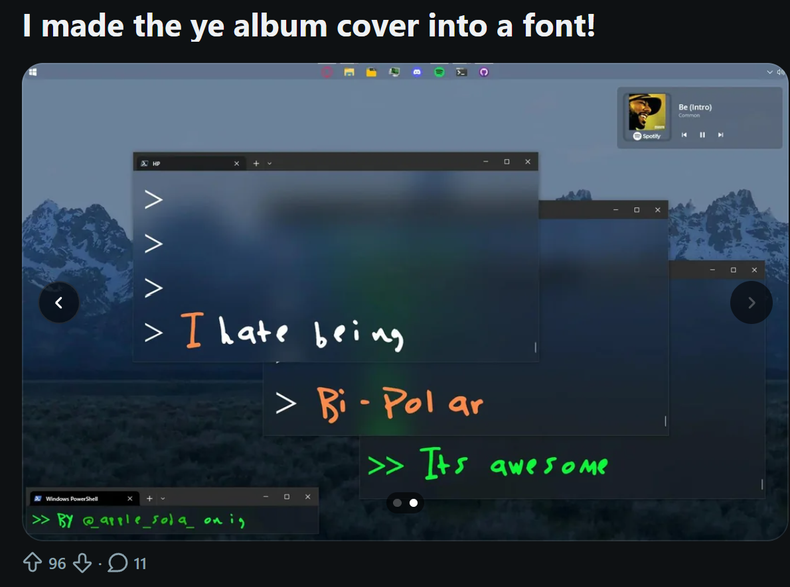

18-11-2026
Visual research en extra les
--
Wat heb ik gedaan?
We hadden eerst de presentatie waarbij we een paar vragen moesten beantwoorden:

- Wat is voor jou de essentie van wat je gepresenteerd heb?
  Kanye West is een van de grootste, invloedrijkste en complexe artiesten ooit. Met de presentatie wou ik een beeld geven over wie hij is.
- Heeft iemand nog een aanvulling?
  Ik had een foutje in mijn presentatie over wanneer Kanye begonnen was maar meer niet.
- Welk gevoel geeft je onderwerp?
  We waren het er met z'n 3en over eens dat het woord stoer het beste paste bij Kanye west (uit de lijst die er was).

Bij visual research zijn we bezig geweest met de template in Miro over het gevoel dat je onderwerp geeft en een crazy 8. Je moest ook een woord geven die het gevoel het beste beschreef. Ik ben voor **Gelaagdheid** gegaan.

Link naar bord: https://miro.com/app/board/uXjVEPsWKDc=/?moveToWidget=3458764690739629018&cot=14

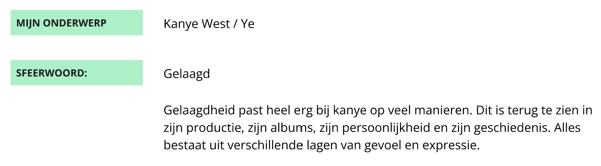

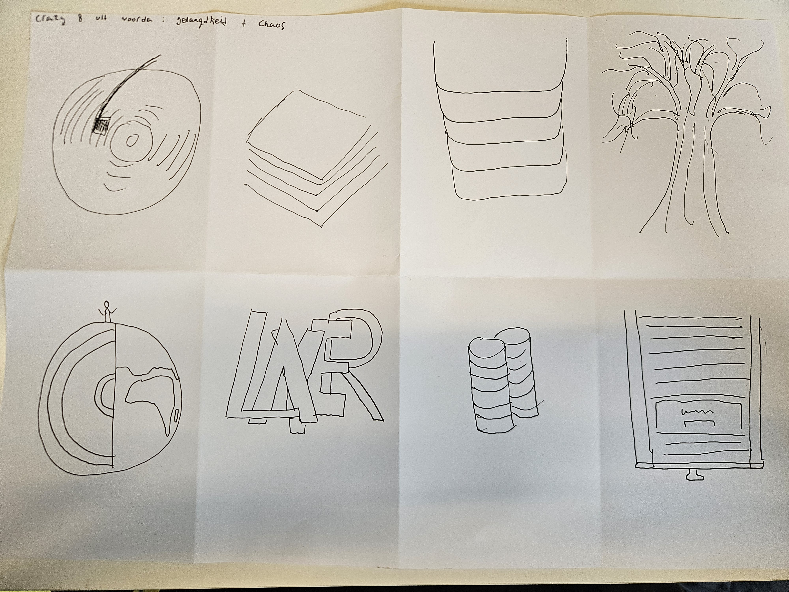

Vragen:

- Wat waren de beste ideeën? Ik vind het terug laten komen van muziek elementen erg belangrijk omdat Kanye West mij vooral muziekaal geraakt heeft (zelf doet ie veel meer dan alleen muziek, denk bijv aan mode). De vinyl en la met platen geven veel gelaagdheid en muziek in een naar voren.
- Zijn uitgangspunten zichtbaar? Ja, er zijn veel laagjes te zien en chaos is terug te zien in de organische boom.
- Is dit online vertaalbaar? Stel ik zou mijn idee met de platen in een la doen kan ik gelaagdheid duidelijk maken via visuele gelaagdheid in de la, maar ook door elke plaat een ander thema en gevoel te geven. Dit geeft gelaagdheid omdat elk hoofdstuk van Kanye dan voelt als een nieuwe aparte laag.
- Is het expressief? Dat denk ik wel. Het lijkt mij heel gaaf om elke periode van Kanye een nieuw gevoel te geven. Dit zorgt wel voor veel uitdaging. Qua animaties heb ik al een idee voor de la. Ik zet de schetsen hieronder.

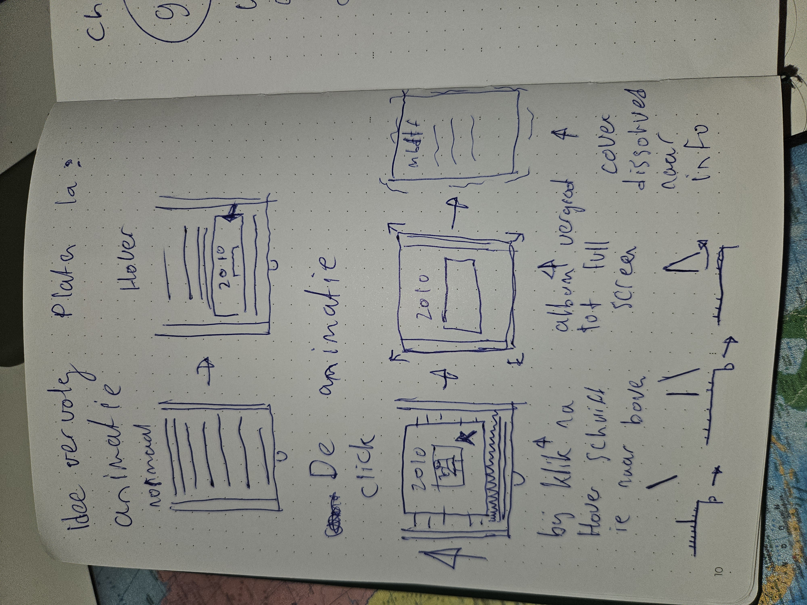

Bij de extra les zijn we bezig geweest met kleur, gradients en patronen. We hebben uitleg gekregen over RGB, HSL en HEX. Ik denk dat ik HSL het handigst vind voor het coderen. Ook is met het nut van variabelen nu duidelijk. Gradients vind ik wel erg interessant, omdat ik denk dat ik het wel goed kan gebruiken bij het tonen van het gevoel van een album. Patronen vond ik zelf best lastig en ik weet ook niet of ik er snel wat mee zou doen.

17-11-2026
Inhalen, presentatie en extra les
--
Wat heb ik gedaan?
Ik heb vandaag de stof van de les van maandag gemaakt, want ik was ziek maandag. De stof hielp goed met het begrijpen van wat een digital garden nou inhoud. Een altijd work in progress verzameling van interesses en experimentjes.

Ik heb mijn presentatie gemaakt over Kanye West. Ik heb Kanye West als onderwerp voor mijn tuintje gekozen, omdat het mijn eerste stadion concert was en ik sinds dat moment veel meer muziek
ben gaan luisteren. Ook lijkt de vele variatie in wie Kanye is en zijn muziek mij een leuke uitdaging om over te brengen via mijn tuintje.

Bij de extra les zijn we bezig geweest met light en dark mode. Het was uiteindelijk niet heel ingewikkeld, maar toch denk ik dat ik er wel moeite mee had gehad als ik de les niet gevolgd had.

13-11-2026
Schetsen
--
Wat heb ik gedaan?
We kregen schetsles waarbij we bezig waren met lijnen, micro-interacties en nog meer. Het tekenen van micro-interacties was erg leerzaam en het maken van schaduw met een grijze stift heeft een nieuwe wereld voor me geopend.

11-11-2026
Font-face
--
Wat heb ik gedaan?
Ik heb de oefeningen met @font-face die we in de les moesten maken gedaan. Het was eerst even zoeken maar uiteindelijk ging het best makkelijk. Ik heb vooral verschillende tekstopmaak geleerd. Ook het gebruik van id’s kwam bij de laatste erg van pas en die snap ik daardoor nu ook een stuk beter. Ik vind wel alle verschillende displays enzo nogal lastig. Ik weet niet precies wat inline, block, flex, inline-block inhoud. Grid snap ik opzich wel maar die vind ik ook nog lastig.

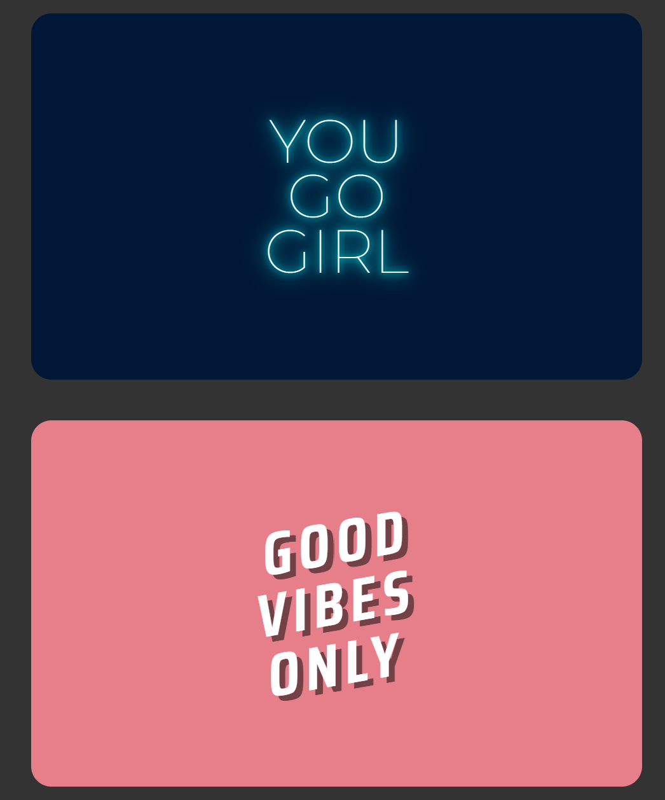
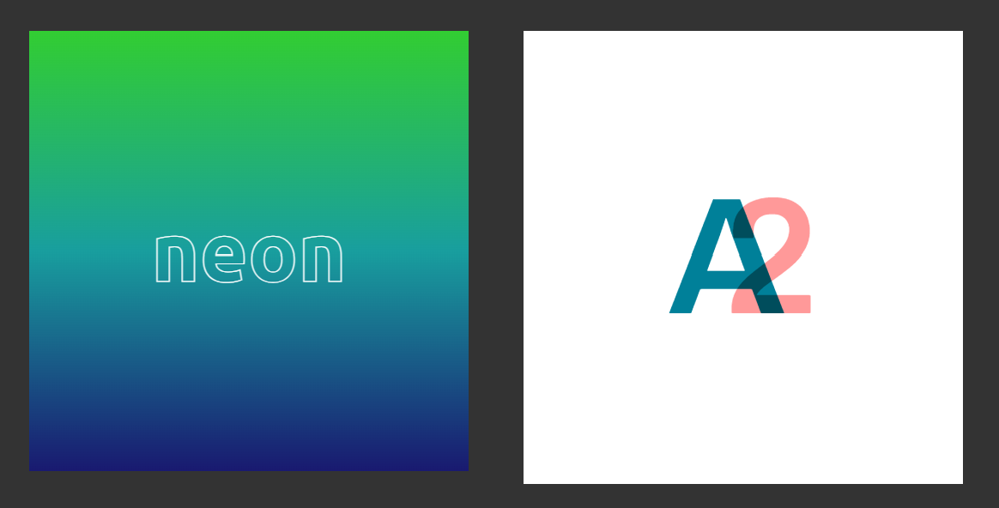
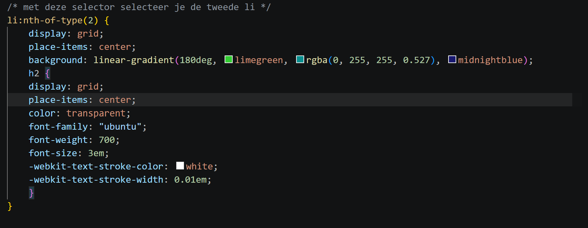
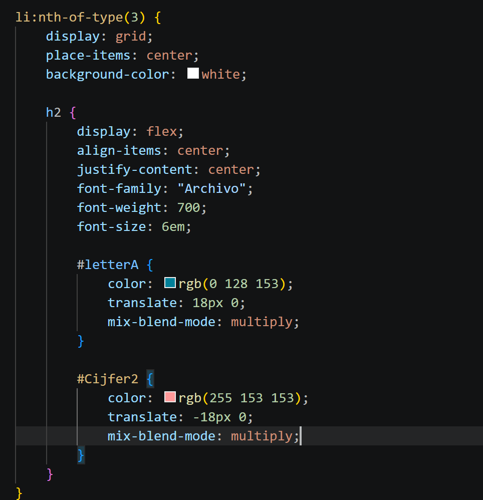

10-11-2026
Afmaken werk van gisteren
--
Wat heb ik gedaan?
Ik heb mijn domeinnaam gekocht: Steunteun.nl Ik vond t wel leuk klinken maar ben niet van plan een donatie website te maken ofzo. Ook heb ik VScodium gedownload en helemaal ingesteld. Dat was even puzzelen maar ik ben eruit gekomen. Ook ben ik gelijk bezig geweest met de website oefening. Hierbij leerde ik verschillende mogelijkheden van HTML zoals het maken van een list of het toevoegen van een afbeelding.

9-11-2026
Eerste check-out
--
Wat heb ik gedaan?
Github account aanmaken en mijn website
Ik heb nog geen domeinnaam gekocht want ik wist nog niet waar ik het over ging hebben.
We hebben in ons groepje gekeken naar wat de vorige studenten gemaakt hebben als inspiratie voor wat we zelf willen gaan doen. Daar ben ik helaas nog niet achter gekomen.
