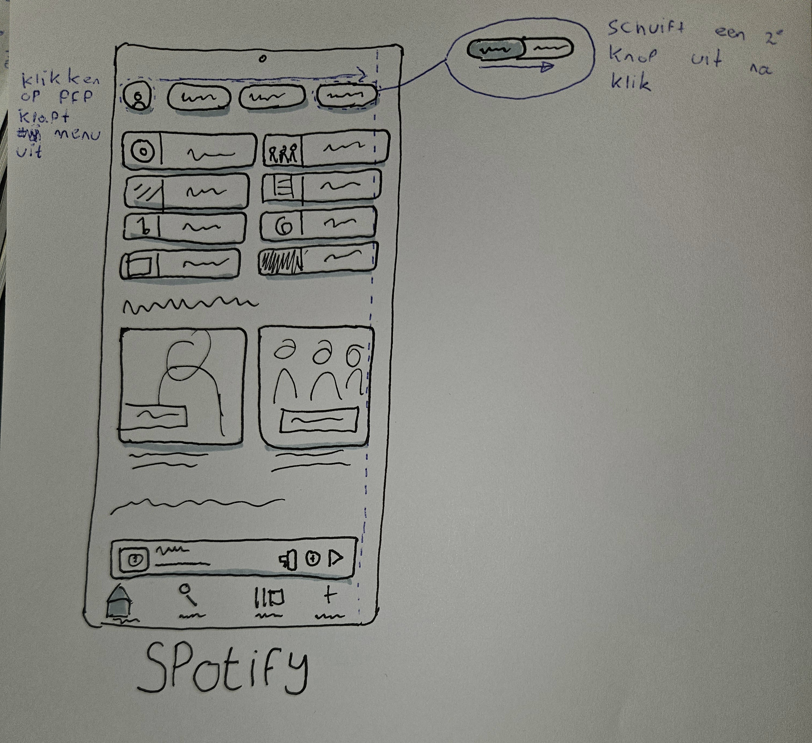

13-11-2026
Schetsen

Wat heb ik gedaan?
We kregen schetsles waarbij we bezig waren met lijnen, micro-interacties en nog meer. Het tekenen van micro-interacties was erg leerzaam en het maken van schaduw met een grijze stift heeft een nieuwe wereld voor me geopend.

11-11-2026
Font-face

Wat heb ik gedaan?
Ik heb de oefeningen met @font-face die we in de les moesten maken gedaan. Het was eerst even zoeken maar uiteindelijk ging het best makkelijk. Ik heb vooral verschillende tekstopmaak geleerd. Ook het gebruik van id’s kwam bij de laatste erg van pas en die snap ik daardoor nu ook een stuk beter. Ik vind wel alle verschillende displays enzo nogal lastig. Ik weet niet precies wat inline, block, flex, inline-block inhoud. Grid snap ik opzich wel maar die vind ik ook nog lastig.

10-11-2026
Afmaken werk van gisteren

Wat heb ik gedaan?
Ik heb mijn domeinnaam gekocht: Steunteun.nl Ik vond t wel leuk klinken maar ben niet van plan een donatie website te maken ofzo. Ook heb ik VScodium gedownload en helemaal ingesteld. Dat was even puzzelen maar ik ben eruit gekomen. Ook ben ik gelijk bezig geweest met de website oefening. Hierbij leerde ik verschillende mogelijkheden van HTML zoals het maken van een list of het toevoegen van een afbeelding.

9-11-2026
Eerste check-out

Wat heb ik gedaan?
Github account aanmaken en mijn website
Ik heb nog geen domeinnaam gekocht want ik wist nog niet waar ik het over ging hebben.
We hebben in ons groepje gekeken naar wat de vorige studenten gemaakt hebben als inspiratie voor wat we zelf willen gaan doen. Daar ben ik helaas nog niet achter gekomen.
